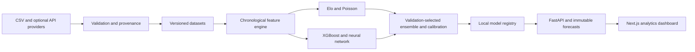

# Premier League AI

A leakage-aware Premier League forecasting platform that combines statistical models, machine learning, probability evaluation, chronological backtesting, FastAPI, and a Next.js research dashboard.

**Educational and research project; not a betting system.** Football outcomes are uncertain, and forecast quality is not guaranteed.

## Overview

The platform estimates home/draw/away probabilities, expected goals, and score distributions for historical evaluations and real scheduled fixtures. It reports calibration, uncertainty, model disagreement, and explanations alongside measured model comparisons and saved pre-kickoff predictions.

## Measured results

The versioned [dataset manifest](docs/dataset-manifest.json) records the five real Football-Data seasons used for the original training run. That snapshot contains 1,570 match records. On the sealed 2025/2026 test season (380 matches), the selected recipe scored **1.0303 log loss**, **0.6195 Brier score**, and **47.37% winner accuracy**. Its separate monthly frozen-recipe walk-forward scored 1.0264 log loss and 48.16% accuracy. The [verification report](docs/verification.md) describes these measurements and their limits. The final test did not select the model. These are historical measurements, not a promise about future forecasts.

## Models

The system compares simple home and frequency baselines, previous-season priors, Elo, regularized Poisson and optional Dixon–Coles, CPU XGBoost, and a small PyTorch network with team embeddings. It evaluates weighted, logistic, and small meta ensembles plus calibration methods in chronological validation. A complex component reaches the saved recipe only when earlier validation supports it. The current champion manifest is recorded under [`docs/model-manifests`](docs/model-manifests/).

## Architecture



Python packages separate providers, validation, data snapshots, feature replay, models, training, evaluation, persistence, inference, and HTTP contracts. SQLite is the local default; PostgreSQL uses the same SQLAlchemy models and Alembic migrations. MLflow tracking stays local.

## Leakage protection

- Each fixture's features are read before its result is applied to team state.
- Simultaneous fixtures share a feature cutoff and are grouped before any result updates.
- Historical outcomes become usable only after their documented availability time.
- Splits are chronological; imputers, scalers, and learned model parameters fit only within each training fold.
- Ensemble and calibration recipes use separated chronological out-of-fold blocks.
- The newest complete season is sealed for final measurement and is never used to revise the selected recipe.

Details and known assumptions are in [data-leakage.md](docs/data-leakage.md).

## Screenshots

`docs/assets/` is reserved for genuine screenshots captured from the running dashboard. The initial repository keeps live captures out until they can be saved as reviewable image files; no mock dashboard images are presented as screenshots.

## Quick start on Windows

Install Git, [uv](https://docs.astral.sh/uv/getting-started/installation/), and Node.js 20.9 or newer. The bootstrapper can install its own managed Python 3.12 runtime. Then clone your **private** repository and set up the application:

```powershell
git clone <private-repository-url>
cd premer_leage_ai
.\scripts\bootstrap.ps1
```

Bootstrap syncs the locked Python and Node dependencies, preserves any existing `.env`, initializes SQLite and migrations, downloads and validates available historical data, prepares features, and checks the local API health endpoint. It does **not** train a model by default. Use `-Train` to train with LIGHT/FAST defaults, or `-SkipData` to install offline. If a provider is unavailable, import a results CSV with the command below. Add a football-data.org token to local `.env` only if you want its optional fixture adapter.

Start these in separate PowerShell windows from the repository root:

```powershell
.\.venv\Scripts\python.exe -m football_ai api
```

```powershell
cd frontend
npm run dev
```

Open the dashboard at [http://127.0.0.1:3000](http://127.0.0.1:3000). API reference: [http://127.0.0.1:8000/docs](http://127.0.0.1:8000/docs). Both servers bind to loopback by default.

## Common commands

Run `football-ai COMMAND` in an activated environment, or replace it with `python -m football_ai COMMAND`.

| Command | Purpose |
| --- | --- |
| `update-data` | Download or import real results and fixtures, version the snapshot, and rebuild features |
| `update-data --offline` | Reuse cached historical result downloads |
| `update-data --csv PATH --season 2024/2025` | Import a historical result CSV |
| `update-data --fixtures PATH` | Import fixtures from a local CSV |
| `train` | Evaluate recipes chronologically and initialize a model when needed |
| `retrain` | Evaluate a candidate with the independent champion promotion gate |
| `evaluate` | Read the saved sealed-test report without selecting a new recipe |
| `backtest` | Run historical chronological replay for a saved recipe |
| `predict-upcoming` | Save forecasts only for known future fixtures |
| `record-results` | Attach actual outcomes to saved forecasts |
| `evaluate-predictions` | Evaluate forecasts saved before kickoff |
| `rollback` | Restore the previous champion pointer |
| `api` | Start FastAPI on localhost port 8000 |

## Local files and fresh-PC recovery

| Local item | Classification | Recreate or transfer |
| --- | --- | --- |
| `.env` | **Secret/configuration** | Created from `.env.example`; configure tokens locally. It is never in the archive or Git. |
| `.venv/` | Regeneratable | `scripts/bootstrap.ps1` or `uv sync --locked` |
| `frontend/node_modules/`, `frontend/.next/`, caches | Regeneratable | `npm ci --prefix frontend`; build output from `npm run build --prefix frontend` |
| `data/raw/` | Optional cache | Download again with `football-ai update-data`; original source URLs and checksums are listed in the tracked dataset manifest. |
| `data/processed/` and feature caches | Regeneratable | `football-ai update-data` |
| `data/football.db` | **Non-regenerable user state** | Apply migrations and ingest data to rebuild match tables. Stop the API and make a private local backup before moving this database to preserve saved forecasts and results. |
| `models/` and `models/champion.json` | Optional trained artifacts | Recreate using `football-ai train`. Exact model binaries remain local and are not in Git. |
| `reports/` | Optional reports | `football-ai evaluate` and `football-ai backtest` |
| `mlruns/` | Optional local tracking history | New experiments recreate it; machine-specific MLflow artifact paths are not in Git. |
| `work/`, `logs/`, Python caches | Temporary/regeneratable | Created as needed by the app and tools. |

All runtime data and binaries stay ignored. Git tracks compact [dataset provenance](docs/dataset-manifest.json) and [trained model manifests](docs/model-manifests/) instead of CSV files, SQLite databases, model binaries, MLflow storage, or reports. The bootstrap's live download may produce a newer dataset snapshot than the one in those research manifests.

## Hardware profiles and dependencies

`LIGHT` is the default and uses two training threads, a compact neural model, and FAST optimization. `STANDARD` increases thread, model, and tuning budgets. `RESEARCH` provides the largest configured budgets; all three retain the same temporal evaluation safeguards. Change the profile in local `.env` or `configs/training.yaml`.

The locked project uses Python 3.12, NumPy, Pandas, SciPy, scikit-learn, XGBoost, PyTorch CPU, Optuna, MLflow, FastAPI, SQLAlchemy, Alembic, SQLite (or optional PostgreSQL), Next.js, TypeScript, Tailwind CSS, and Recharts.

## Study the project

This repository is also an AI engineering learning project. Follow the ordered [study guide](docs/study-guide.md), which links the mathematics to the implementation and practical exercises.

## Limitations and roadmap

The training set is modest for a volatile sport. The initial source does not provide reliable xG, injuries, lineups, or player form, so those signals are absent rather than invented. Some historical availability times are inferred conservatively. Calibration and uncertainty estimates have finite samples and can drift; no method removes match randomness. The default models are CPU-oriented.

Future work could add richer historical seasons, timestamped xG, player observations, verified injury and lineup information, deeper prospective tracking, a player-form module, and tactical research. Those items are not implemented capabilities.

**This is an educational and research football forecasting project. It does not offer betting advice or betting functionality.**
