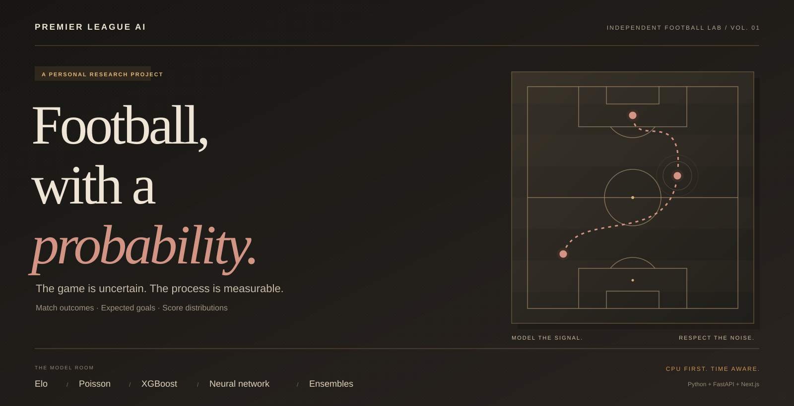
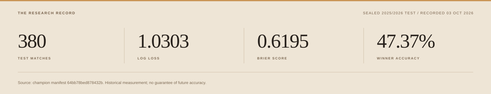
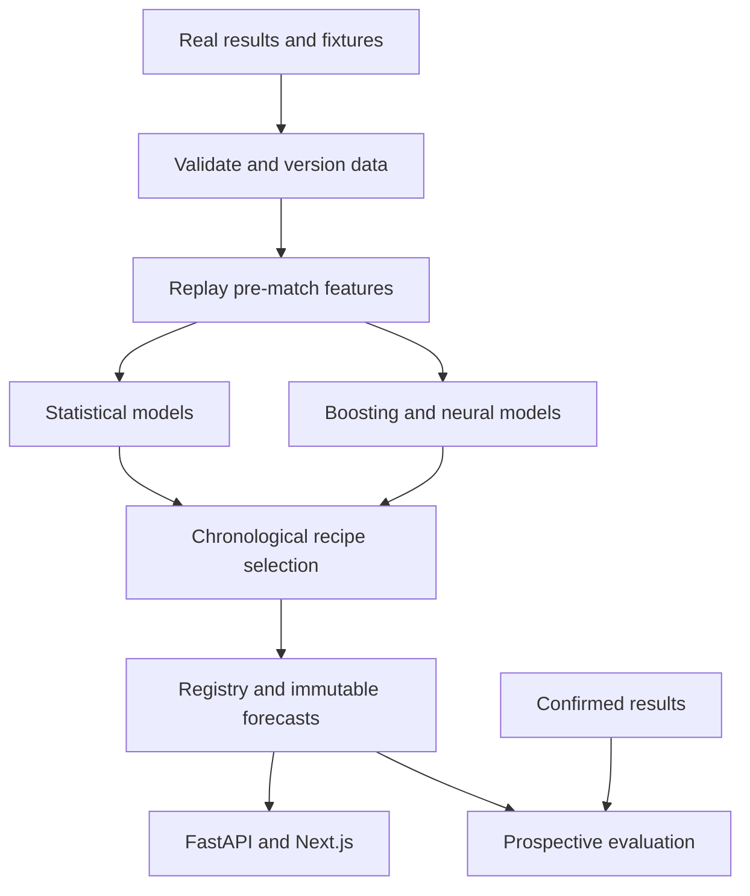

<p align="center">
  
</p>

<p align="center">
  <strong>A personal football project with a research mindset.</strong><br />
  Match probabilities, expected goals, and score distributions—backed by chronological evaluation.
</p>

<p align="center">
  <a href="#01--the-matchday-view"><strong>The experience</strong></a>
  &nbsp; / &nbsp;
  <a href="#02--the-research-record">Measured results</a>
  &nbsp; / &nbsp;
  <a href="#03--inside-the-model-room">Model room</a>
  &nbsp; / &nbsp;
  <a href="#05--run-the-lab">Run locally</a>
  &nbsp; / &nbsp;
  <a href="docs/study-guide.md">Study guide ↗</a>
</p>

<p align="center">
  <a href=".github/workflows/ci.yml"></a>
  
  
  
</p>

---

## 01 / The matchday view

Football is unpredictable. This project explores how much useful signal can be extracted from past results, team strength, and recent form—and how honestly that signal can be measured.

The platform connects a Python forecasting pipeline to a FastAPI service and a Next.js dashboard. It is an independent personal project for football interest and experimentation, with a documented evaluation process.

| Before kickoff | Under the surface |
| :--- | :--- |
| **Home / draw / away probabilities** | Compare the likely outcomes rather than showing only one pick. |
| **Expected goals & score distributions** | Explore how the model distributes probability across possible scores. |
| **Model comparisons & disagreement** | Inspect how different forecasting approaches view the same match. |
| **Team context & explanations** | Explore form and the diagnostics available for the saved recipe. |
| **Saved forecasts & confirmed results** | Keep predictions made before kickoff separate from later outcomes. |

The dashboard includes a matchday homepage, individual prediction pages, team views, and a research page. It reads stored/provider data; it is not a live score feed. Upcoming predictions require actual scheduled fixtures.

## 02 / The research record



These figures come from the committed [initial champion manifest](docs/model-manifests/64bb78bed878432b.json) and [verification report](docs/verification.md), recorded on **3 October 2026**. They describe a historical run; they are not a claim about current or future performance.

| Evaluation protocol | Matches | Log loss ↓ | Brier score ↓ | Winner accuracy ↑ |
| :--- | ---: | ---: | ---: | ---: |
| Sealed 2025/2026 final test | 380 | 1.0303 | 0.6195 | 47.37% |
| Monthly frozen-recipe walk-forward | 380 | 1.0264 | 0.6172 | 48.16% |

**What those numbers mean:** log loss measures the probabilities assigned to the outcomes that occurred; Brier score measures squared probability error. Accuracy counts how often the highest-probability outcome won. None of these numbers alone establishes superiority over a baseline.

The original [dataset snapshot](docs/dataset-manifest.json) contains **1,570 match records** across **2022/2023–2026/2027**, with the final season partial. New downloads can produce a different snapshot.

<details>
<summary><strong>Trace the recorded experiment</strong></summary>

| Record | Value |
| :--- | :--- |
| Initial champion | `64bb78bed878432b` |
| Selected recipe | Small meta ensemble |
| Members | Elo · Poisson · XGBoost · Neural network |
| Calibration | No transform selected |
| Test season | 2025/2026 |
| Compute profile / seed | LIGHT / 42 |
| Source-archived candidate | `2b56024500ad43a6`; recorded as a candidate, not a replacement champion |

Selection used earlier chronological validation. The final test measured the recipe after selection and did not choose it.

The [delivery verification](docs/verification.md) records the original checks and their date. Its test counts are historical evidence, not a claim that checks were rerun for this README update.

</details>

## 03 / Inside the model room

Start with simple expectations. Add complexity when earlier validation supports it.

| Family | Question it asks | Implementation |
| :--- | :--- | :--- |
| **Baselines** | What happens if we favor home advantage or historical frequencies? | [Baseline models](src/football_ai/models/baseline.py) |
| **Elo** | How strong are the teams relative to each other? | [Rating engine](src/football_ai/features/elo.py) · [Model](src/football_ai/models/elo.py) |
| **Poisson / Dixon–Coles** | What scorelines follow from estimated scoring rates? | [Goal models](src/football_ai/models/poisson.py) |
| **XGBoost** | Can nonlinear combinations of pre-match features improve forecasts? | [Boosting model](src/football_ai/models/boosting.py) |
| **Compact neural network** | Can learned team embeddings capture additional structure? | [Neural model](src/football_ai/models/neural.py) |
| **Ensembles & calibration** | Does combining or adjusting probabilities help on earlier validation? | [Ensembles](src/football_ai/models/ensemble.py) · [Calibration](src/football_ai/models/calibration.py) |

Weighted, logistic, and small meta ensembles are evaluated. A model being implemented does not mean it belongs to the selected recipe.

## 04 / Time is part of the model

A forecast should only know what was available when it was made.

- **Features before results:** a match outcome enters team state only after its availability cutoff.
- **Simultaneous fixtures stay together:** they share the same prior information.
- **Training follows the calendar:** preprocessing, ensemble fitting, calibration, and selection respect temporal boundaries.
- **The newest complete season stays sealed:** final-test results do not revise the selected recipe.
- **Forecasts remain immutable:** confirmed outcomes attach separately.

Read the [leakage safeguards](docs/data-leakage.md), [evaluation design](docs/evaluation.md), and [backtesting notes](docs/backtesting.md).



SQLite is the default store. PostgreSQL uses the same SQLAlchemy models and Alembic migrations. Tracking and artifacts stay local.

## 05 / Run the lab

Built for a laptop: **Windows native, CPU first, no GPU required.** The default LIGHT profile uses two training threads, a compact neural model, and FAST optimization.

Install Git, [uv](https://docs.astral.sh/uv/getting-started/installation/), and Node.js 20.9 or newer. Bootstrap can install managed Python 3.12.

```powershell
git clone https://github.com/aeubs66/premer_leage_ai.git
cd premer_leage_ai
.\scripts\bootstrap.ps1
```

Bootstrap installs locked dependencies, initializes the database, prepares available historical data, and checks API health. **Training is separate by default.** Use `-Train` to include training or `-SkipData` for offline setup.

Start the API from the repository root:

```powershell
.\.venv\Scripts\python.exe -m football_ai api
```

Start the dashboard in another terminal:

```powershell
cd frontend
npm run dev
```

[Open local dashboard](http://127.0.0.1:3000) · [Open API reference](http://127.0.0.1:8000/docs)

A fresh clone does not contain trained model binaries or saved predictions. Train locally or restore matching private local state. See the full [Windows setup guide](docs/getting-started.md).

<details>
<summary><strong>Data, training, and forecasting commands</strong></summary>

Use `football-ai COMMAND` in the activated environment, or `.\.venv\Scripts\python.exe -m football_ai COMMAND` from the root.

| Command | Purpose |
| :--- | :--- |
| `update-data` | Update real data, version the snapshot, and rebuild features |
| `update-data --offline` | Reuse cached historical downloads |
| `update-data --csv PATH --season 2024/2025` | Import historical result CSV data |
| `update-data --fixtures PATH` | Import scheduled fixtures |
| `update-data --api-fixtures` | Use the optional token-authenticated fixture adapter |
| `train` | Evaluate recipes and initialize a model when needed |
| `train --no-neural` | Omit the neural learner |
| `retrain` | Evaluate a candidate through the champion promotion gate |
| `evaluate` | Read the saved sealed-test report |
| `backtest` | Replay the saved recipe chronologically |
| `predict-upcoming` | Save forecasts for known future fixtures |
| `record-results` | Attach actual outcomes to saved forecasts |
| `evaluate-predictions` | Evaluate forecasts saved before kickoff |
| `rollback` | Restore the previous champion pointer |

A first training run and later candidate promotion have different roles. Consult [reproducibility](docs/reproducibility.md) before comparing runs.

</details>

<details>
<summary><strong>Moving to another PC: what Git does and does not preserve</strong></summary>

| Local item | Recovery |
| :--- | :--- |
| `.env` | Recreate locally from the example; keep tokens private |
| `.venv/`, `frontend/node_modules/` | Reinstall locked dependencies |
| `data/raw/` | Download again; provenance is recorded in the dataset manifest |
| `data/processed/` | Rebuild with the data pipeline |
| `data/football.db` | Stop the API and back up privately to preserve saved forecasts and results |
| `models/` | Retrain or privately transfer matching artifacts and champion pointer |
| `reports/`, `mlruns/` | Preserve privately if you need the exact report and tracking history |
| `work/`, `logs/`, caches | Temporary or regeneratable |

Git tracks source, configuration examples, dataset provenance, and compact model manifests. It does not carry the database or trained binaries. See [recovery details](docs/reproducibility.md).

</details>

## 06 / Explore further

| Follow the evidence | Follow the implementation |
| :--- | :--- |
| [Study guide](docs/study-guide.md) — concepts and exercises | [Feature engine](src/football_ai/features) — historical replay |
| [Data pipeline](docs/data-pipeline.md) — sources and validation | [Training](src/football_ai/training) — selection and registry |
| [Calibration](docs/calibration.md) — probability diagnostics | [Inference](src/football_ai/inference) — forecast generation |
| [Experiments](docs/experiments.md) — research workflow | [Evaluation](src/football_ai/evaluation) — metrics and reports |
| [Architecture](docs/architecture.md) — boundaries and decisions | [Dashboard](frontend/src) — matchday and research views |

**Current boundaries.** The initial source lacks reliable xG, injuries, lineups, and player form. Historical result-availability times include documented conservative assumptions. Fixture coverage depends on the provider. Richer player data and tactical features remain future possibilities.

**Independent personal project.** No affiliation with the Premier League or its clubs. This is a football forecasting experiment, not a betting service.

[Contributing](CONTRIBUTING.md) · [Security](SECURITY.md) · [Report an issue](https://github.com/aeubs66/premer_leage_ai/issues)

---

<p align="center">
  <em>The score is uncertain. Keep the evidence clear.</em>
</p>
